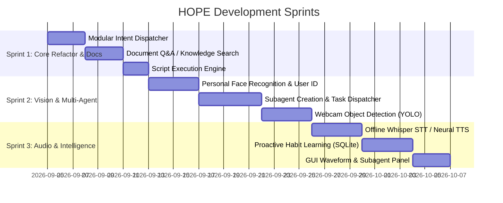

# 📋 Project HOPE - Master Task & Remaining TODO List

> **Project**: Human-Oriented Personal Engine (HOPE)  
> **Status**: Active Development (~75% – 80% Complete)  
> **Last Updated**: September 2026  
> **Architecture**: Local-First, Pure Python Assistant  

---

## 📊 Phase Progress Summary

| Phase | Description | Status | Progress |
| :--- | :--- | :--- | :--- |
| **Phase 1: Core Interaction (MVP)** | Voice input, TTS, basic command routing, short-term history | ✅ Completed | 100% |
| **Phase 2: Personality & Memory** | Cynical engine, empathy mode, humor levels, SQLite persistence | ✅ Completed | 100% |
| **Phase 3: System Control & Tools** | Web tools, OS control, email (Gmail/IMAP), WhatsApp, diagnostics | 🟡 In-Progress | 85% |
| **Phase 4: Vision & Multimodal** | Camera feed, face detection, screen/cam Math OCR solver | 🟡 In-Progress | 70% |
| **Phase 5: Advanced Intelligence** | Intent classification, local vector knowledge base, habit learning | ⏳ Upcoming | 35% |

---

## 🎯 High-Priority Remaining Tasks

### 🧠 1. Local Document / Knowledge Base (RAG-Lite)
- [ ] **Connect Local Document Parser to Query Engine**:
  - Integrate [Resources/extracted_text.txt](file:///d:/Personal/Anti-Gravity/Project%20HOPE/version%202/Resources/extracted_text.txt) / PDF reader into real-time voice queries.
  - Implement a lightweight local TF-IDF or BM25 keyword search index across stored documents in `Resources/`.
  - Add voice trigger: *"Hope, search my documents for [query]"* or *"Hope, what does the PRD say about [topic]?"*.
- [ ] **Dynamic Document Ingestion**:
  - Add utility to drop `.pdf`, `.txt`, or `.md` files into a `docs_library/` folder and have HOPE index them automatically.

---

### 👁️ 2. Advanced Vision & Biometrics (Phase 4 Completion)
- [ ] **Multi-User Face Enrollment & Recognition**:
  - Upgrade [hope/security/face_recognition.py](file:///d:/Personal/Anti-Gravity/Project%20HOPE/version%202/hope/security/face_recognition.py) from generic Haar Cascade detection to face recognition with user profiles stored in `learning/faces/`.
  - Train/embed known faces (e.g. Master/User) and trigger personalized voice greetings upon recognition (*"Welcome back, Sir"* vs *"Unknown user detected"*).
- [ ] **Object Detection via Webcam (YOLO / MediaPipe)**:
  - Integrate a lightweight local YOLOv8-nano or MediaPipe object detection pipeline.
  - Voice command: *"Hope, what do you see?"* -> describes detected objects, phones, mugs, people in front of the lens.
- [ ] **Visual Scene & Color Analysis**:
  - Add simple OpenCV scene description (dominant colors, motion detection alerts while in standby).

---

### ⚡ 3. Automation & System Control (Phase 3 Polish)
- [ ] **Safe Script Execution Engine**:
  - Create a secure script runner in [hope/offline/apps.py](file:///d:/Personal/Anti-Gravity/Project%20HOPE/version%202/hope/offline/apps.py) to trigger predefined `.bat`, `.ps1`, or `.py` automation workflows.
  - Add voice trigger: *"Hope, run routine [routine_name]"* (e.g., "dev setup", "cleanup").
- [ ] **Screen Brightness & Power Controls**:
  - Add OS brightness adjustment via `screen_brightness_control` library.
  - Add safe sleep/lock workstation voice triggers (*"Hope, lock my PC"* -> `rundll32.exe user32.dll,LockWorkStation`).
- [ ] **Active Process Manager & Selective App Closer**:
  - Enhance app closing to target specific running processes (e.g. *"Hope, close Chrome"*, *"Hope, kill Spotify"*) rather than generic `Alt+F4`.

---

### 🧩 4. Intelligent Architecture & Dispatcher (Phase 5)
- [ ] **Modular Intent Router (Decouple `features.py`)**:
  - Refactor the long `if/elif` chain in [hope/features.py](file:///d:/Personal/Anti-Gravity/Project%20HOPE/version%202/hope/features.py) into a registry/decorator pattern (`@intent_handler("open_app", keywords=[...])`).
  - Improve regex and semantic pattern matching for faster extensibility.
- [ ] **Habit Learning & Proactive Suggestions**:
  - Track time-of-day execution frequency in SQLite database (e.g., user opens VS Code every weekday at 9 AM).
  - Enable HOPE to proactively suggest routines (*"Sir, it's 9:00 AM. Would you like me to open your workspace?"*).
- [ ] **Local Offline SLM / LLM Fallback (Optional)**:
  - Add optional bridge to a local lightweight model (e.g., Ollama / Llama-3-8B / Phi-3 via local HTTP endpoint) for open-ended conversational queries without breaking zero-API privacy.

---

### 🤖 5. Autonomous Multi-Agent System & Subagent Delegation (Phase 5)
- [ ] **Dynamic Subagent Creation Engine**:
  - Enable HOPE to autonomously scaffold and create specialized worker agents to reduce main engine workload.
  - Auto-generate structured agent packages inside [agents/](file:///d:/Personal/Anti-Gravity/Project%20HOPE/version%202/agents) with a standardized folder hierarchy:
    ```
    agents/
    └── <agent_name>/
        ├── config.json       # Metadata, agent role, capabilities, triggers
        ├── agent.py          # Execution logic and worker loop
        ├── tools/            # Specialized scripts & utilities for the agent
        ├── tasks/            # Task queue (pending.json / completed.json)
        └── logs/             # Execution traces & subagent run logs
    ```
  - Voice trigger: *"Hope, create an agent named [name] for [purpose]"* (e.g. *"Hope, create an agent named Researcher to fetch articles"*).
- [ ] **Agent Lifecycle Management & Task Dispatcher**:
  - HOPE tracks, launches as background subprocesses/threads, pauses, and kills worker agents.
  - Asynchronous task offloading: HOPE assigns long-running tasks (e.g. web scraping, file cleanup, continuous data monitoring) to subagents so her primary voice/GUI loop remains 100% responsive.
  - Voice triggers:
    - *"Hope, list active agents"*
    - *"Hope, assign task [task] to [agent_name]"*
    - *"Hope, check status of agent [agent_name]"*
    - *"Hope, terminate agent [agent_name]"*
- [ ] **Inter-Agent Communication & Result Aggregation**:
  - Subagents write execution results back via local JSON queues or IPC.
  - HOPE consumes finished tasks and sarcastically/empathetically reports findings back to the user (*"Sir, your Researcher subagent finally did its job. Here is the summary."*).

---

### 🎙️ 6. Voice & Speech Enhancements (Audio Engine)
- [ ] **Offline Speech-to-Text (Faster-Whisper / Vosk)**:
  - Add an offline STT fallback mode using `faster-whisper` (tiny/base model) or `Vosk` so voice recognition works with zero internet.
- [ ] **Natural Neural Text-to-Speech (Piper / Edge-TTS)**:
  - Add an option to switch from robotic Windows SAPI5 `pyttsx3` to a ultra-realistic local neural voice engine (like Piper TTS or Edge-TTS) with custom sarcastic pitch inflections.

---

### 🖥️ 7. GUI Dashboard Upgrades
- [ ] **Dynamic Animated Avatar / Visualizer**:
  - Add a pulsing orb or audio waveform visualizer on [hope/gui/dashboard.py](file:///d:/Personal/Anti-Gravity/Project%20HOPE/version%202/hope/gui/dashboard.py) that reacts when HOPE is listening vs speaking.
- [ ] **Vision Live Overlay Toggle**:
  - Add a direct switch on the GUI sidebar to toggle between raw camera feed, face ID bounding boxes, and OCR math solver overlays.
- [ ] **Subagent Monitor Panel**:
  - Add an active subagent status tracker widget to the GUI dashboard showing running worker agents, CPU usage, and current assigned tasks.

---

## 🗓️ Recommended Execution Roadmap



---

## 📦 Reference Archive: Completed Features

For reference, the following features are already implemented, tested, and fully functional:

- [x] **Dual Interface**: CLI engine ([main.py](file:///d:/Personal/Anti-Gravity/Project%20HOPE/version%202/main.py)) + Full Tkinter Dashboard ([gui_main.py](file:///d:/Personal/Anti-Gravity/Project%20HOPE/version%202/gui_main.py)).
- [x] **Cynical & Empathy Personality**: Dual-tone engine with 0–10 humor scaling and sarcastic decorators.
- [x] **SQLite Persistence**: History logging, user preference storage, and recall functions ([hope/core/memory.py](file:///d:/Personal/Anti-Gravity/Project%20HOPE/version%202/hope/core/memory.py)).
- [x] **Hardware Health Monitor**: Continuous CPU, RAM, battery, and disk tracking with automatic sarcastic thresholds ([hope/system_stats/monitor.py](file:///d:/Personal/Anti-Gravity/Project%20HOPE/version%202/hope/system_stats/monitor.py)).
- [x] **Math OCR Solver**: Screen grab + Camera OCR equation detection and step-by-step arithmetic/algebra solver ([hope/offline/math_solver.py](file:///d:/Personal/Anti-Gravity/Project%20HOPE/version%202/hope/offline/math_solver.py)).
- [x] **Navigation & Mapping**: Nominatim geocoding, multi-location resolution, and OSRM route duration/distance calculation ([hope/online/maps.py](file:///d:/Personal/Anti-Gravity/Project%20HOPE/version%202/hope/online/maps.py)).
- [x] **Communication**: Gmail OAuth2 & IMAP reader + WhatsApp Web automation ([hope/communication/](file:///d:/Personal/Anti-Gravity/Project%20HOPE/version%202/hope/communication)).
- [x] **Standby Mode & Wake Control**: Low-overhead passive state listening.
- [x] **Interactive Architecture Graph**: Real-time neural node graph visualization ([hope/gui/graph_visualization.py](file:///d:/Personal/Anti-Gravity/Project%20HOPE/version%202/hope/gui/graph_visualization.py)).
